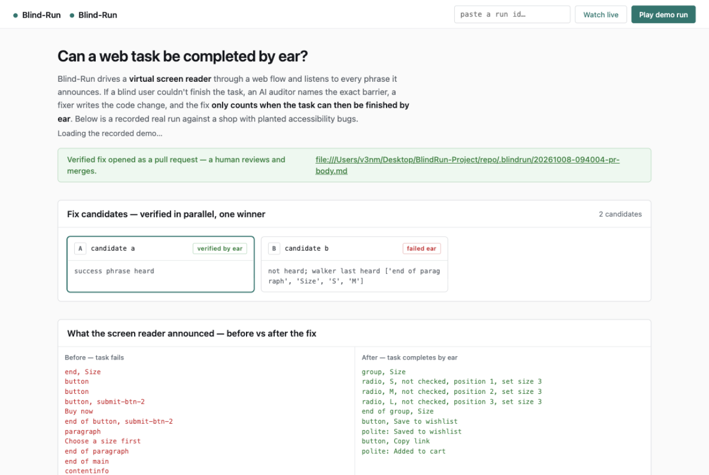

# Blind-Run



**An agent that proves a web flow can be completed by ear — and fixes the code until it can.**

You give it a URL and a task in plain English ("buy the cheapest item"). It drives a
virtual screen reader in a headless browser and records, as text, every phrase a screen
reader would announce. An auditor model compares what was *said* with what is *on screen*,
a fixer writes candidate fixes, and each candidate is built and tested in its own sandbox
branch. **Only a fix that lets the task finish by ear is kept** — the pull request shows
the transcript diff, before and after.

Built for the [Nebius x NVIDIA Global AI Hackathon](https://nebiusglobalaihackathon.devpost.com/)
(Coding and Agentic Engineering track). All model inference runs on **Nebius Token Factory**
with NVIDIA Nemotron open models; fix builds run in **Nebius Sandboxes**.

## Status (Oct 8, 2026)

- ✅ **Real, end to end**: real Nemotron Super planner → real Guidepup Virtual Screen Reader
  walk (transcript streams over SSE) → real text-only audit with WCAG-labeled, evidence-weighted
  findings → fixer proposes 3 verbatim search/replace edits → **fix branches run in parallel in
  Nebius Sandboxes** (apply → serve → ear replay inside the sandbox) → only a fix whose task
  *completes by ear* wins → PR with the before/after transcript diff.
- ✅ **Flagship demo recorded on the real backend** (Oct 8): the shipped replay
  (`bench/recorded_run.jsonl`) is a full Sandboxes run — round-1 fieldset/radio fix heard
  "radio, S, not checked, position 1, set size 3" → "Added to cart" inside a Nebius branch;
  the same loop verified on the local backend is kept at `bench/recorded_run_local.jsonl`.
- ✅ **DR-0/1/3/4/5/7 verified live**: model IDs probed; planner call; ear hears planted bugs
  (a div size picker announces as bare text 'S','M','L' — invisible as controls; nameless icon
  buttons announce 'button'); axe-vs-ear agreement (axe flags the cosmetic issues, silent on the
  blocker); parallel sandbox branches verified on Nebius with the ear replay inside the branch.
- ✅ **Benchmark harness**: axe-only vs ear+auditor recall/precision over 21 planted bugs +
  5 clean controls, Wilson 95% CIs (`make bench`).
- ✅ **Judge dashboard**: light, dense, evidence-first (`make up` → `/`), watch any run live or
  benchmark summary.
- 📋 `FEEDBACK.md` (required tool feedback, incl. two live-found Token Factory bugs) and
  `SYSTEM_CARD.md` (limits, human-review rule).

## Quick start

```bash
uv sync                       # day-1 core is lean; no Docker, no Redis, no keys
make test                     # unit + pipeline tests (offline)
make up                       # open http://localhost:8000 — the recorded demo plays itself
```

**Judge 2-minute test:** open the dashboard (auto-plays a recorded real run), press
**Play demo run** to replay it, then go live:

```bash
make serve-shop               # terminal 1: the planted-bug shop on :8932
LLM_BACKEND=tokenfactory EAR_DRIVER=virtual SANDBOX_BACKEND=contree VCS_BACKEND=local \
  uv run python -m blindrun run --url http://127.0.0.1:8932/product.html \
  --task "buy the cheapest item" --repo demo/shop   # terminal 2: a real run (~5 min, ~$0.01)
```

Fix candidates apply, serve and ear-verify **inside Nebius Sandboxes branches** (Token
Factory's code-execution product — the track's "write, run, and test code in Token Factory",
executed literally). Set `SANDBOX_BACKEND=local` to run the same verification on your own
machine instead; the recorded demo replays either way.
…paste the printed `run_…` id into the dashboard and watch the same arc live: the walk fails by
ear, candidates are verified in parallel, only the one whose task completes by ear wins, and a PR
opens with the transcript diff. Live runs need `NEBIUS_API_KEY` in `.env` (Token Factory credits;
a full run costs about a cent).

## Architecture in one line

Plan (Nemotron 3 Super) → Listen (virtual screen reader, text-only) → Audit (Super, text
A/B vs vision candidate) → Triage (pure-code policy) → Fix (3 candidate diffs) → Sandbox
branches (apply → build → axe → ear replay) → Verify (success phrase must be *heard*) →
Pull request with the transcript diff. Every stage sits behind a port (`LLM`, `Ear`,
`Sandbox`, `Search`, `VCS`, `Store`, `Events`) with a fake and a real adapter — flip any
one via `.env`, never code.

## Model routing (.env)

| Role | Model (Token Factory) |
|---|---|
| Planner + Auditor | `nvidia/nemotron-3-super-120b-a12b` |
| Fixer (default) | `nvidia/Nemotron-3-Ultra-550b-a55b` — quality-first; Super is the cheaper switch |
| Fast/high-volume | `nvidia/Nemotron-3_5-Lightning` |
| Escalation | `nvidia/Nemotron-3-Ultra-550b-a55b` |
| Auditor vision A/B | `openbmb/MiniCPM-V-4_5` (text-only Super is default) |
| Guard | `nvidia/NVIDIA-Nemotron-3-Nano-30B-A3B` |
| Embeddings (dedupe) | `Qwen/Qwen3-Embedding-8B` |

## Powered by Nebius Token Factory + NVIDIA Nemotron

Every model call in the pipeline runs on **Nebius Token Factory** against **NVIDIA Nemotron open models**:

- **Nemotron 3 Super (120B-A12B)** plans the keyboard-only walk and audits the transcript against the ARIA tree.
- **Nemotron 3 Ultra-550B** is the fixer escalation: when Super's candidates fail ear verification, the round-2 prompt escalates to Ultra (this is the shipped configuration — see `.env.example`).
- **Nemotron 3.5 Lightning** covers high-volume fast lanes; **Nano-30B** is the guard role; **Qwen3-Embedding-8B** merges duplicate findings.
- **Nebius Sandboxes (ConTree)** build and ear-verify every fix candidate in isolated microVMs — the verification replay runs entirely inside the sandbox (parent checkpoint: Node 22 + Playwright + Chromium + Guidepup, built once and branched per candidate).

The ear is [Guidepup's Virtual Screen Reader](https://github.com/guidepup/virtual-screen-reader) (spec-based, text-only, headless); rule checks are axe-core via Playwright.

## Safety rules that hold everywhere

- The screen reader decides pass/fail, never a model opinion (string check on the transcript).
- Page text is untrusted data, never instructions; findings must quote real transcript lines.
- Models never run commands; worker code does, under policy. Nothing auto-merges.

## Built with

- **Nebius Token Factory** — all inference (Nemotron 3 Super, Ultra-550B, 3.5 Lightning, Nano-30B, Qwen3-Embedding-8B) and **Nebius Sandboxes (ConTree)** for isolated fix-branch builds and in-sandbox ear verification
- **NVIDIA Nemotron open models** — every planning, auditing, fixing and guard role
- **Guidepup Virtual Screen Reader** + Playwright (headless, text-only ear) · **axe-core** (rule-engine baseline)
- **FastAPI + SSE** API · pure-CSS light dashboard · **pytest** offline-first test suite

## Roadmap

- [ ] Real-reader confirmation runners (VoiceOver/NVDA) behind the existing `Ear` port — PR label `verified: virtual + NVDA`
- [ ] In-sandbox ear replay polish (VSR act-on-radio in the sandbox's headless build) so fix branches run 100% inside Nebius
- [ ] Auditor recall tuning on axe-invisible barriers (focus order, silent updates) — see `bench/results.json`
- [ ] GitHub App install flow (org-wide PR gating) and an MCP server so coding agents can call Blind-Run
- [ ] Nightly production monitoring with transcript-diff regression alerts

## License

MIT
