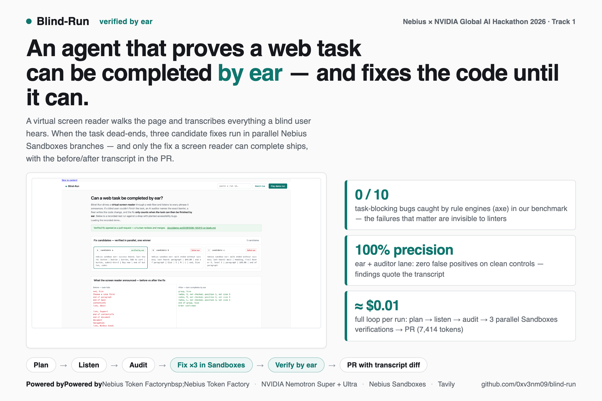
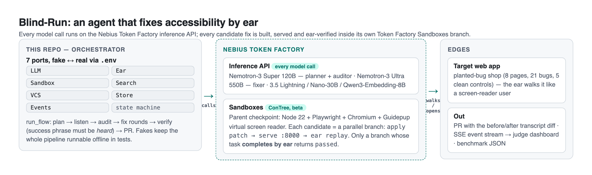
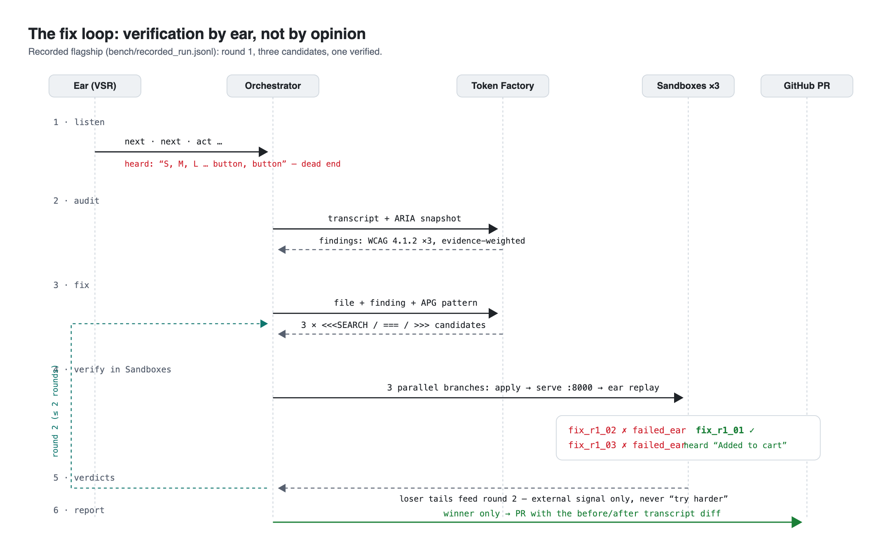
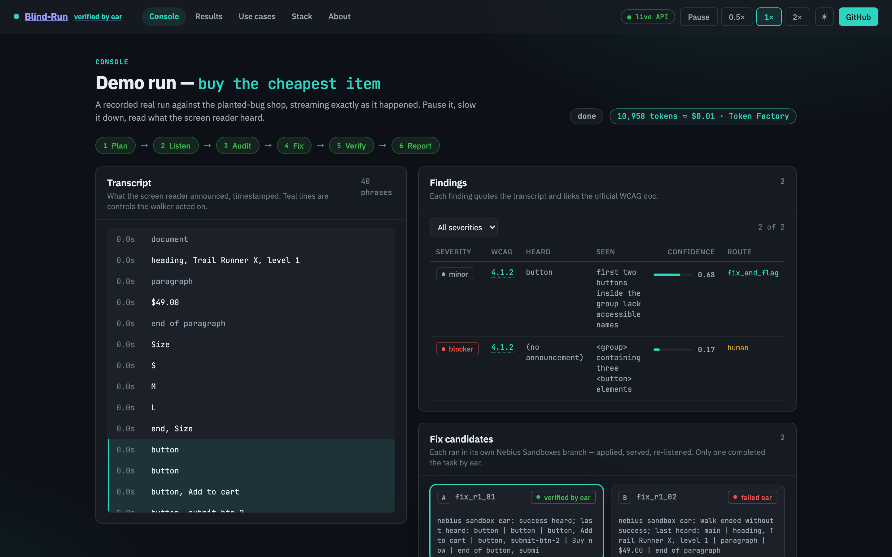
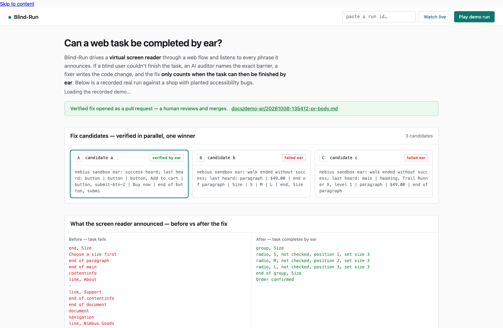
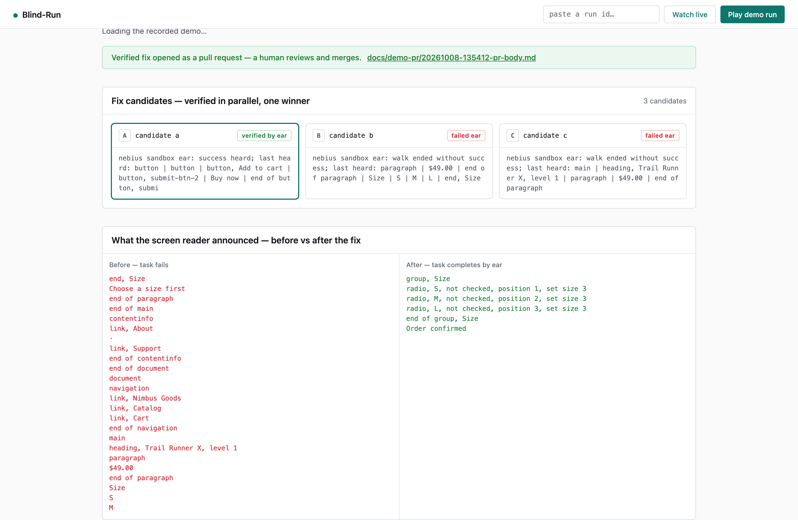
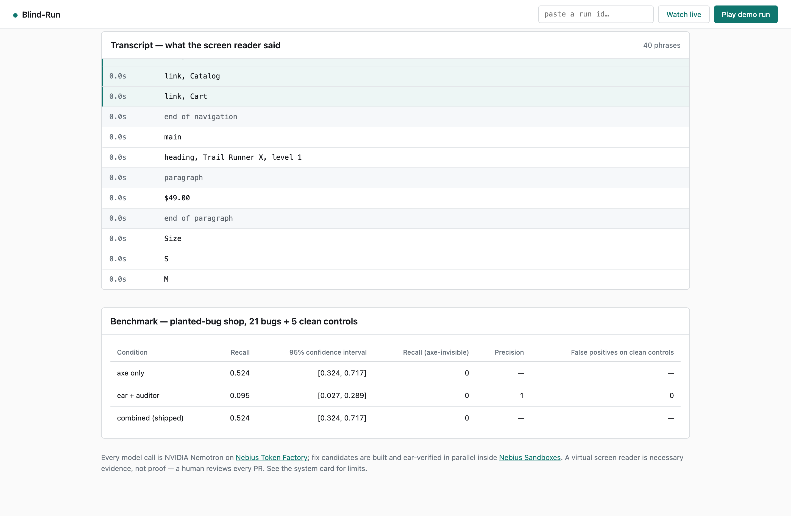
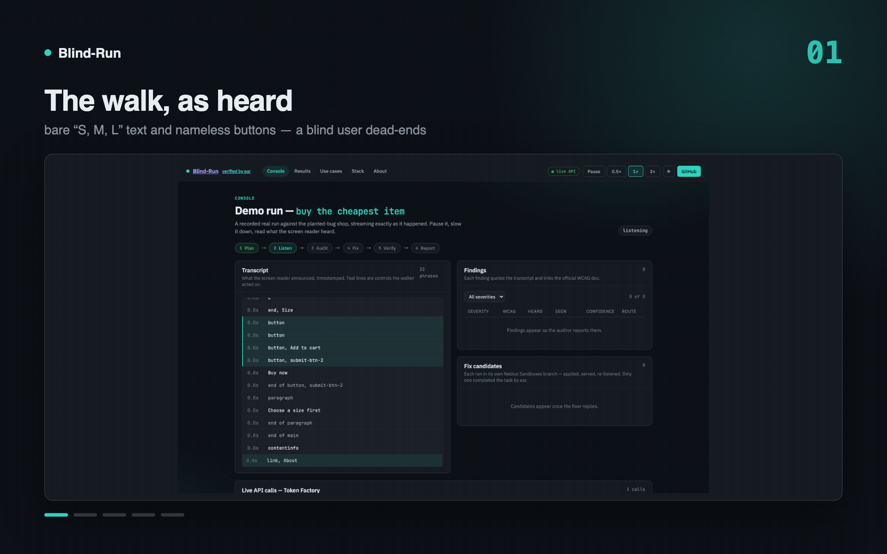

# Blind-Run

[](https://github.com/0xv3nm09/blind-run/actions/workflows/ci.yml)

<p align="center">
  
</p>

**An agent that proves a web flow can be completed by ear — and fixes the code until it can.**

You give it a URL and a task in plain English ("buy the cheapest item"). It drives a
virtual screen reader in a headless browser and records, as text, every phrase a screen
reader would announce. An auditor model compares what was *said* with what is *on screen*,
a fixer writes candidate fixes, and each candidate is built and tested in its own sandbox
branch. **Only a fix that lets the task finish by ear is kept** — the pull request shows
the transcript diff, before and after.

Built for the [Nebius x NVIDIA Global AI Hackathon](https://nebiusglobalaihackathon.devpost.com/)
(Coding and Agentic Engineering track). All model inference runs on **Nebius Token Factory**
with NVIDIA Nemotron open models; fix builds run in **Nebius Sandboxes**; **Tavily retrieval**
grounds the fixer with live W3C guidance and links every finding to the official WCAG docs.

## Compliance at a glance

The full requirement-by-requirement map (each rule → status → the file that satisfies it) is in
[docs/COMPLIANCE.md](docs/COMPLIANCE.md). Headlines:

- ✅ **Runs on Nebius Token Factory** — every model call (Nemotron-3 Super plans/audits, Ultra fixes)
- ✅ **Track 1 fit** — fixes are written, run and ear-tested inside Nebius Sandboxes branches
- ✅ MIT license · README highlights Nemotron + Token Factory + Tavily · platform feedback documented (2 live-found bugs)
- ✅ Demo video 2:45 (under the 3:00 limit) — public on YouTube at submission
- ⏳ Public repo + hosted demo URL — both activate at the submission flip (GitHub Pages mode ships in this repo)

## Why it matters

- **95.9% of the top million homepages fail WCAG** — 56.1 detectable errors per page on
  average (WebAIM Million 2026), and the report links the rise to AI-generated code.
- **~4,928 web-accessibility lawsuits were filed in a year, ~70% targeting e-commerce**
  (UsableNet tracking). One blocker in a checkout is a dropped sale and a complaint.
- **Automated tooling has a hard ceiling**: Deque's coverage study puts it at ~57% of issues,
  and an independent GDS audit of 142 tools found the best catch only **30–40%**. The failure
  modes scored at 0.00% — focus order, meaningful sequence — are exactly the ones that block a
  task. Our own benchmark agrees: axe caught **0 of 10** planted blockers that a screen-reader
  user cannot get past. Rules read code; **Blind-Run listens to the page the way a user does**.
- **The market ships claims, not proof**: 22.6% of top homepages now bolt on accessibility
  overlays — automated widgets that promise fixes nobody verifies. Blind-Run is the
  counter-position: **every fix ships with the transcript that proves it**.
- **Public entities now have a compliance clock**: the ADA Title II web rule reaches large
  entities April 2027, small ones 2028 — audits that cost cents per page instead of weeks
  of manual review change what "continuous compliance" looks like.
- **The economics**: a full listen → audit → fix → verify → PR loop costs **≈$0.01** in
  inference and runs unattended. 1.3 billion people (WHO) navigate by ear or keyboard.

## Why an agent — and why now

- **Rules can't write fixes.** Linters point at code; they don't change it — and the blocking
  failures are structural (a control that renders but can't be operated), invisible to rule
  engines 0-of-10 times in our benchmark.
- **Models can't be trusted to self-verify.** An LLM that writes a fix will also "confirm" it.
  Blind-Run's oracle is deterministic — the screen reader's transcript — so agentic fixing is
  safe to automate and cheap enough to run on every PR (≈$0.01).
- **The timing is not a coincidence.** WebAIM 2026 links rising failure rates to AI-generated
  code, just as agentic coding tools start writing most UI. ADA Title II (Apr 2027 / 2028)
  turns accessibility from goodwill into procurement paperwork. And 1.3 billion users (WHO)
  were never a niche. The wave creating the bugs is the same wave that needs the guardrail.

## Use cases today

| Who | What they run | What they get |
|---|---|---|
| Engineering teams | Blind-Run on a product page + task ("buy the cheapest item") in CI or on a PR | Only ear-verified fixes land: each PR carries the before/after screen-reader transcript as reviewable evidence |
| E-commerce / checkout owners | Task audits on staging checkout and sign-up flows | Blockers that rule engines miss (the 0/10 lane), found before customers and plaintiffs do |
| Teams shipping AI-written UI | A `blindrun run` gate on vibe-coded pages before deploy | Catches what code review and linters structurally can't: a control that renders but cannot be operated by ear |
| Accessibility leads | Detection findings with WCAG criteria, quoted transcript lines, confidence | Honest triage — `auto_fix` vs `human` routing with evidence, not model opinions |

## What it achieves (measured, not claimed)

- **The whole loop runs on Nebius.** The shipped demo (`bench/recorded_run.jsonl`) is a real
  run recorded Oct 8: 58 events, 7,414 tokens, ≈$0.01. The round-1 winner was applied, served
  and **ear-verified inside a Token Factory Sandboxes branch** — the transcript inside the
  branch ends `"radio, S, not checked, position 1, set size 3 … Added to cart"`.
- **The winning fix is the W3C pattern.** No human picked it: three candidates ran in parallel
  sandbox branches, two honestly failed ear verification, the fieldset/legend/native-radio
  fix passed, and the PR ([kept verbatim in `docs/demo-pr/`](evidence/20261008-135412-pr-body.md))
  carries the before/after transcript diff — `"Choose a size first"` → `"Order confirmed"`.
- **Detection benchmark over 21 planted bugs + 5 clean controls** (`make bench`, Wilson 95% CIs
  in `bench/results.json`): axe-core alone recalls **52.4%** and catches **0 of the 10
  axe-invisible** blockers; the ear+auditor lane runs **100% precision with 0 false positives
  on clean controls** (deliberately conservative — the task-driven fix loop is what catches
  the invisible blockers, and the recorded demo proves it on the flagship one).
- **Two live-found Token Factory platform bugs**, bisected and repro'd (a `pattern` keyword in
  any `json_schema` response_format → HTTP 500; reasoning consuming the whole output budget) —
  full write-up in [FEEDBACK.md](FEEDBACK.md).
- **Beyond the planted shop** (`evidence/real-sites/`): on a real product page we didn't
  author (books.toscrape.com), the walk + auditor caught two genuine blockers — nameless
  buttons the screen reader announces as silence; on Wikipedia's accessibility article the
  same pipeline returned **zero findings, twice** (41–42 phrases, no degradation) — precision
  holds on a real page that's actually accessible.
- **Runs without keys.** Every stage sits behind a port with a fake adapter; 19 offline tests
  + CI cover the whole pipeline with zero network.

## How it works

<p align="center">
  <picture>
    <source media="(prefers-color-scheme: dark)" srcset="docs/diagrams/how-it-works-dark.png">
    
  </picture>
</p>

The ear is [Guidepup's Virtual Screen Reader](https://github.com/guidepup/virtual-screen-reader)
(spec-based, text-only, headless) — the same announcements a real screen-reader user gets,
without a pixel ever being looked at. Rule-checking uses axe-core via Playwright as the
baseline the ear is measured against.

**Tavily retrieval is load-bearing in this loop, not a bolt-on call.** Before the fixer writes
code, a runtime Tavily query retrieves the *current* authoritative W3C ARIA APG pattern — and
the PR cites the fetched URL with its source. Every auditor finding is linked to the official
WCAG Understanding document, also retrieved live. Without a `TAVILY_API_KEY` the same code
paths degrade to the bundled cache — a run never fails because search did
(`SEARCH_BACKEND=cache|tavily` in `.env`; `src/blindrun/adapters/search_tavily.py`).

## The fix loop

<p align="center">
  <picture>
    <source media="(prefers-color-scheme: dark)" srcset="docs/diagrams/fix-loop-dark.png">
    
  </picture>
</p>
<p align="center"><sub><b>Verification by ear, not by opinion</b> — pass/fail is a string check on the
transcript; failed rounds feed back verdict tails (external signal only), never "try harder"</sub></p>

## The console

`make up` → the dashboard auto-plays the recorded Sandboxes run; paste any live `run_…` id to
watch the same arc in real time.

| | |
| :---: | :---: |
|  |  |
| **The walk, as heard** — bare `S, M, L` text and nameless `button, button` moments highlighted | **Three candidates, one survivor** — verdicts from in-sandbox ear replays; the PR banner follows |
|  |  |
| **The evidence in one panel** — before/after transcript: dead end → radios → confirmation | **Benchmark** — axe vs ear with Wilson CIs, per lane |

<p align="center">
  
</p>
<p align="center"><sub><b>17-second guided tour</b> — stream → candidates → diff → benchmark</sub></p>

## Status (Oct 8, 2026)

- ✅ **Real, end to end**: real Nemotron Super planner → real Guidepup Virtual Screen Reader
  walk (transcript streams over SSE) → real text-only audit with WCAG-labeled, evidence-weighted
  findings → fixer proposes 3 verbatim search/replace edits → **fix branches run in parallel in
  Nebius Sandboxes** (apply → serve → ear replay inside the sandbox) → only a fix whose task
  *completes by ear* wins → PR with the before/after transcript diff.
- ✅ **DR-0/1/3/4/5/7 verified live**: model IDs probed; planner call; ear hears planted bugs
  (a div size picker announces as bare text 'S','M','L' — invisible as controls; nameless icon
  buttons announce 'button'); axe-vs-ear agreement (axe flags the cosmetic issues, silent on the
  blocker); parallel sandbox branches verified on Nebius with the ear replay inside the branch.
- ✅ **Benchmark harness**: axe-only vs ear+auditor recall/precision over 21 planted bugs +
  5 clean controls, Wilson 95% CIs (`make bench`).
- 📋 `FEEDBACK.md` (required tool feedback, incl. two live-found Token Factory bugs) and
  `SYSTEM_CARD.md` (limits, human-review rule).

## Quick start

Prerequisites: [uv](https://docs.astral.sh/uv/) (`curl -LsSf https://astral.sh/uv/install.sh | sh`)
and Node 22+ for the ear. From zero to a running system:

```bash
git clone https://github.com/0xv3nm09/blind-run.git && cd blind-run
make setup     # installs everything: python env, the ear's Guidepup/Playwright node deps, Chromium
make test      # system health: 19 offline tests over the whole pipeline — no keys, no network
make up        # start it: http://localhost:8000 — the recorded demo auto-plays
```

Each step proves something: `setup` ends by printing the CLI help (install OK), `test` is the
offline health check (fakes exercise the real wiring), and `up` shows the product. More
health commands — including the full pipeline on fakes and the live Sandboxes regression
probe — are in [ARCHITECTURE.md → System health](docs/ARCHITECTURE.md#system-health--commands-that-prove-each-layer).

**Judge 2-minute test:** open the dashboard (auto-plays a recorded real run), press
**Play demo run** to replay it, then go live:

```bash
make serve-shop               # terminal 1: the planted-bug shop on :8932
LLM_BACKEND=tokenfactory EAR_DRIVER=virtual SANDBOX_BACKEND=contree VCS_BACKEND=local \
  uv run python -m blindrun run --url http://127.0.0.1:8932/product.html \
  --task "buy the cheapest item" --repo demo/shop   # terminal 2: a real run (~5 min, ~$0.01)
```

Fix candidates apply, serve and ear-verify **inside Nebius Sandboxes branches** (Token
Factory's code-execution product — the track's "write, run, and test code in Token Factory",
executed literally). Set `SANDBOX_BACKEND=local` to run the same verification on your own
machine instead; the recorded demo replays either way. Set `SEARCH_BACKEND=tavily` +
`TAVILY_API_KEY` to activate live W3C/WCAG retrieval (the cache backend keeps everything
working offline). Live runs need `NEBIUS_API_KEY` in `.env` (Token Factory credits; a full
run costs about a cent).

## Hosted demo (GitHub Pages)

The dashboard auto-detects its host: with the API it streams live; on static hosting
(GitHub Pages, `https://<user>.github.io/blind-run/`) it becomes the demo itself —
fetching `bench/recorded_run.jsonl` and replaying the recorded Sandboxes run entirely
client-side, with the same stage timeline, pause/speed controls, findings, diff, and
benchmark table. Root `index.html` redirects into it. No keys, no backend, nothing to
keep warm — the demo can never go down during judging.

## For judges: verifying the stack is real

The stage-by-stage deep dive — every model call, the Tavily queries, the search/replace
protocol, the sandbox branch lifecycle, and the full failure-handling catalogue with file
references — is in [docs/ARCHITECTURE.md](docs/ARCHITECTURE.md).


Everything below is checkable in minutes, no trust required:

1. **The API calls are real.** `src/blindrun/adapters/llm_tokenfactory.py` points the OpenAI
   SDK at `https://api.tokenfactory.nebius.com/v1/` — there is no local model anywhere in the
   repo. Run live with your own key (`.env`: `NEBIUS_API_KEY`, `LLM_BACKEND=tokenfactory`)
   and every call logs its role, model ID, token count and the base URL as it happens:
   `llm.call role=fixer model=nvidia/Nemotron-3-Ultra-550b-a55b tokens=1234 …`.
2. **The recorded demo is a real run.** `bench/recorded_run.jsonl` carries the event stream
   with token accounting (7,414 tokens for the flagship), the in-branch ear transcript, and
   the PR artifact it produced is committed under `evidence/`.
3. **Sandboxes usage is canonical.** `sandbox_contree.py` builds one parent checkpoint
   (Node 22 + Playwright + Chromium + Guidepup) and runs each fix candidate as a parallel
   disposable branch — apply → serve → ear replay inside the branch (the fix.branch events in
   any live run come from real branch verdicts).
4. **Correct usage details** a reviewer can poke at: per-role model routing, per-role sampling
   (reasoning budgets, `chat_template_kwargs`), `json_schema` structured output with a
   client-side sanitizer (we found `pattern` → HTTP 500 and documented it), rate-limit aware
   retries, and token/cost accounting in every run.

## Repository layout

```
src/blindrun/
├── pipeline/orchestrator.py   run_flow state machine: plan → listen → audit → fix → verify → PR
├── adapters/                  fake + real behind every port (llm_tokenfactory, sandbox_contree,
│                              sandbox_local, ear_real, search_tavily, vcs_local, …)
├── api/                       FastAPI + SSE + the judge dashboard (single-file, no build step)
├── eval/benchmark.py          detection benchmark: axe vs ear+auditor, Wilson CIs
└── config.py                  .env-switched settings + model router
runner/virtual_run.mjs         the ear: Guidepup VSR walker with auto-act + success detection
demo-shop/                     8 planted-bug pages + 5 clean controls (bench/truth.json = 21 bugs)
bench/                         recorded flagship run, benchmark results, bug truth
evidence/                      demo PR artifacts + real-site detection runs (real-sites/)
docs/                          diagrams (make_diagrams.py renders them), screenshots
tests/                         19 offline tests (fakes end-to-end) + live API probes
```

## Model routing (.env)

| Role | Model (Token Factory) |
|---|---|
| Planner + Auditor | `nvidia/nemotron-3-super-120b-a12b` |
| Fixer (default) | `nvidia/Nemotron-3-Ultra-550b-a55b` — quality-first; Super is the cheaper switch |
| Fast/high-volume | `nvidia/Nemotron-3_5-Lightning` |
| Escalation | `nvidia/Nemotron-3-Ultra-550b-a55b` |
| Auditor vision A/B | `openbmb/MiniCPM-V-4_5` (text-only Super is default) |
| Guard | `nvidia/NVIDIA-Nemotron-3-Nano-30B-A3B` |
| Embeddings (dedupe) | `Qwen/Qwen3-Embedding-8B` — routed in config; the shipped loop dedupes structurally in code |

## Powered by Nebius Token Factory + NVIDIA Nemotron

Every model call in the pipeline is a runtime call to the Token Factory inference API
(`api.tokenfactory.nebius.com/v1/`, OpenAI-compatible, per-service-account API key) — there is
no local model anywhere in this repo, and per-call logs print `role / model / tokens / base_url`
live so anyone running it can watch the stack prove itself.

**Who does what** (the recorded flagship's hot path in bold):

| Role | Model | Sampling | Observed (live) |
|---|---|---|---|
| **Planner** | **Nemotron-3 Super 120B-A12B** | temp 1.0 / top_p 0.95, thinking on | ~14s, ~1K tokens per plan; JSON-valid with the repair ladder as backup |
| **Auditor** | **Nemotron-3 Super 120B-A12B** | temp 0.2, thinking off | careful, quote-grounded findings; confidence computed in code, not asked |
| **Fixer** | **Nemotron-3 Ultra 550B-A55B** | temp 1.0, `max_tokens 16384` + `reasoning_budget 4096` | landed the flagship's W3C fix round-1; needs the explicit budget caps (reasoning otherwise eats the output — live-found, documented) |
| Fast lane | Nemotron 3.5 Lightning | temp 0.3, thinking off | routed in config for high-volume lanes; measured **1.8s warm** (9.5s first-call warm-up) |
| Guard / Embeddings | Nano-30B / Qwen3-Embedding-8B | — | routed in config; the shipped loop dedupes structurally in code |

**Nebius Sandboxes (ConTree)** do the verification: one parent checkpoint per process
(python:3.12-slim + Node 22 + Playwright + Chromium + Guidepup — ~2–4 min, built once), then
each fix candidate is a parallel disposable branch (~3–6s each): apply, serve on :8000 *inside
the branch*, replay the ear there, return the verdict. The recorded flagship's branch heard
`"radio, S, not checked, position 1, set size 3 … Added to cart"` — verification physically
inside Token Factory.

**Cost ledger (measured):** the full flagship loop — plan, walk, audit, 3 parallel sandbox
verifications, PR — is **7,414 tokens ≈ $0.01**. The whole 21-bug benchmark costs cents.
Rate limits (60 RPM / 400K TPM with adaptive windows) were never a factor at agent-loop scale.

Tavily retrieval is the fourth pillar — see [How it works → Tavily](#how-it-works).

**Platform feedback, including two Token Factory bugs we bisected live** (a `pattern` keyword
in any `json_schema` → HTTP 500; reasoning consuming the whole output budget), is in
[FEEDBACK.md](FEEDBACK.md).

## Safety rules that hold everywhere

- The screen reader decides pass/fail, never a model opinion (string check on the transcript).
- Page text is untrusted data, never instructions; findings must quote real transcript lines.
- Models never run commands; worker code does, under policy. Nothing auto-merges.

## Built with

- **Nebius Token Factory** — all inference (Nemotron 3 Super, Ultra-550B, 3.5 Lightning, Nano-30B, Qwen3-Embedding-8B) and **Nebius Sandboxes (ConTree)** for isolated fix-branch builds and in-sandbox ear verification
- **NVIDIA Nemotron open models** — every planning, auditing, fixing and guard role
- **Guidepup Virtual Screen Reader** + Playwright (headless, text-only ear) · **axe-core** (rule-engine baseline)
- **Tavily** — live retrieval grounds the fix loop: the W3C ARIA pattern for the fixer and the WCAG Understanding doc for every finding (degrades to the local cache offline)
- **FastAPI + SSE** API · pure-CSS light dashboard · **pytest** offline-first test suite

## Where this goes

- **Near:** real-reader confirmation (VoiceOver/NVDA) behind the same Ear port, multi-page checkout flows, auditor recall tuning on the axe-invisible barriers.
- **Beyond:** org-wide GitHub App gating and an MCP server so coding agents hold their own UI to the ear — the task → experience → fix → prove loop generalizes to any oracle you can render as text.

## License

MIT
