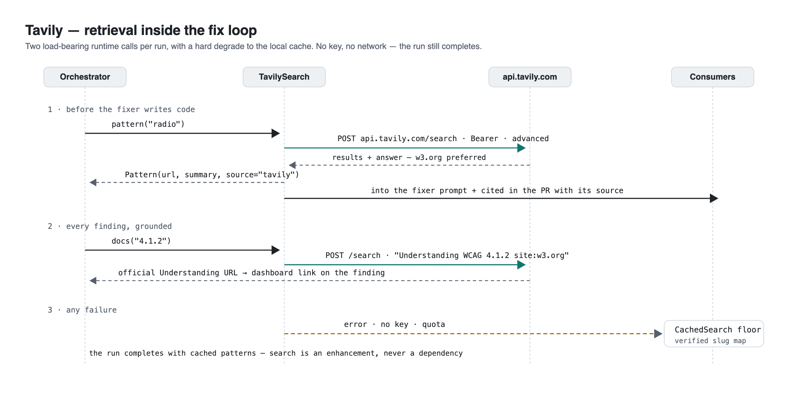

# Tavily — retrieval inside the fix loop

Tavily is the **Search port's real adapter** and a load-bearing part of the fix loop —
not a decorative integration. This page documents the architecture, the exact calls, the
degradation contract, and the records.



## 1. The two runtime calls

Both calls happen **at run time, inside the pipeline** — the fixer does not write code
until its retrieval has returned, and no finding is reported without its grounding link.

### 1.1 `pattern(widget)` — before the fixer writes code

When the auditor triages a barrier (e.g. a silent radio group), the orchestrator calls:

```python
pattern = await deps.search.pattern("radio")  # widget category from the finding
```

- **Request:** `POST https://api.tavily.com/search` · header `Authorization: Bearer <key>`
  · body `{"query": "W3C ARIA Authoring Practices Guide radio pattern keyboard interaction",
  "search_depth": "advanced", "max_results": 4, "include_answer": true}`
- **Selection:** the first result on a `w3.org` domain is preferred; the Tavily answer
  summary becomes the pattern summary
- **Consumed by:** the **fixer prompt** (guidance + keyboard model), and the **PR body**,
  which cites the fetched URL with its source — `[source: tavily]` vs `[source: cache]`
- **Why it matters:** the fixer receives the *current* authoritative W3C ARIA APG
  guidance, not a frozen copy baked into the repo

### 1.2 `docs(wcag_sc)` — every finding, grounded

Each finding the auditor emits is grounded with the official standard:

```python
wcag_url = await deps.search.docs("4.1.2")  # → w3.org Understanding URL
```

- **Request:** `POST /search` · `"Understanding WCAG Success Criterion 4.1.2 site:w3.org"`
- **Consumed by:** the dashboard's findings table (every WCAG SC is a link) and the
  findings API payload

## 2. The degradation contract

Any failure — no key, network error, quota — **degrades to `CachedSearch`** and the run
completes: bundled APG patterns for the fixer, and a **live-verified slug map** for the 13
WCAG criteria we emit (real W3C URLs use names like `name-role-value.html`; unknown SCs
fall back to the Understanding index — never a dead link). Search is an enhancement,
never a dependency. The source of every result (`tavily` or `cache`) is recorded.

## 3. Records

- **Offline behavior records:** 4 tests pin the contract with a mocked transport —
  call shape, w3.org preference, HTTP-500 degrade, no-key degrade
  ([`tests/unit/test_search_tavily.py`](../tests/unit/test_search_tavily.py)).
- **In-pipeline records:** as of Oct 27 the pipeline emits a `search.call` event for every
  retrieval (kind, query, source, url) into the run recording — the same stream that holds
  `llm.call`. A cache-backend verification run recorded **2 `search.call` events**
  (`docs("WCAG 4.1.2")`, `source: "cache"`, name-role-value URL) — the emission path is
  proven end-to-end.
- **Live-call records: DONE (Oct 27).** 8 runs with `SEARCH_BACKEND=tavily` recorded
  **34 live Tavily calls** (8× `pattern` into the fixer prompt, 26× `docs` grounding
  findings), all `source: "tavily"`, interleaved with the Nemotron `llm.call` events in
  the committed streams — including the checkout fix run (R-006: 4 calls across 2 fix
  rounds). Fullest take:
  [`evidence/real-sites/tavily-run-R005.jsonl`](../evidence/real-sites/tavily-run-R005.jsonl)
  — full record: [RUN-RECORDS.md → R-005](RUN-RECORDS.md). The fix-sampling verdicts in
  these takes are the documented variance; the verified-PR proof is R-001.

## 4. Bonus-lane mapping

The hackathon rules award **"Best Use of Tavily — $3,000 — all eligible submissions that
make a functional, runtime call to the Tavily API as part of its solution."** The mapping:

| Rule phrase | Blind-Run |
|---|---|
| *functional, runtime call* | `httpx` POST per barrier + per finding, at run time — logged as `search.call` events |
| *as part of its solution* | the retrieved pattern enters the fixer prompt and the PR citation; the retrieved WCAG doc is the finding's reference — removal would degrade the fix loop |
| *best use* | retrieval gated by a verification loop and cited in the artifact a human reviews — retrieval with accountability |

Adapters: [`search_tavily.py`](../src/blindrun/adapters/search_tavily.py) (real) ·
[`search_fake.py`](../src/blindrun/adapters/search_fake.py) (cache floor) · wiring:
[`deps.py`](../src/blindrun/deps.py) · tests:
[`test_search_tavily.py`](../tests/unit/test_search_tavily.py).
